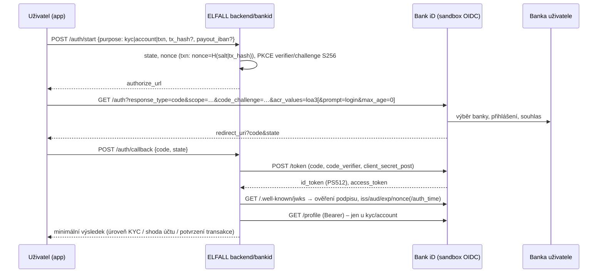

# Bank iD (Bankovní identita) – integrace (SANDBOX)

Stav: **experimentální, feature flag vypnutý** (`IdentityFlags.bankIdEnabled = false`, iOS `BankIdFlags.enabled = false`, web `BANKID_ENABLED = false`). Jen sandbox `https://oidc.sandbox.bankid.cz/`. Produkce je v kódu zablokována (`BANKID_ENV=production` vyžaduje navíc `BANKID_ALLOW_PRODUCTION=1`).

## Architektura

- `backend/` – Kotlin/Ktor (JVM) služba, ověřování JWT přes nimbus-jose-jwt. Drží `client_secret`, PKCE verifier, nonce a jednorázový state; vyměňuje code, ověřuje id_token přes JWKS (`iss`, `aud`, `azp`, `exp`, `iat`, `nonce`, u transakce `auth_time`). Původní Python/FastAPI verze je jen v historii gitu (commit e22bf48).
- Algoritmy: Bank iD dle discovery (`id_token_signing_alg_values_supported`) podporuje **pouze PS512** – proto zůstává povolen. Navíc PS256 a ES256 (rotace). **RS256, HS\*, `none` jsou odmítnuty.**
- iOS: `BankIdLoginFlow` (shared) + `BankIdAuthSession.swift` (ASWebAuthenticationSession, ephemeral) + `SecureEnclaveSigner.swift` (P-256/ES256 v Secure Enclave, biometrie); návratové schéma `elfall://`.
- `shared/.../identity/IdentityVerifier.kt` – rozhraní `IdentityVerifier`, implementace `BankIdVerifier` (volá backend), `WithdrawalGate`.
- UI: tlačítko **„Ověřit přes Bank iD“** v Nastavení (Android/iOS/web) a **„Potvrdit výběr přes Bank iD“** v kroku před výběrem/odesláním (Android/iOS). Napojení tlačítek na otevření prohlížeče (Custom Tab / ASWebAuthenticationSession) je TODO – flag je vypnutý.

Hodnoty z OIDC discovery sandboxu (`/.well-known/openid-configuration`, ověřeno 2026-10-13): `authorization_endpoint=/auth`, `token_endpoint=/token`, `profile_endpoint=/profile`, `userinfo_endpoint=/userinfo`, `jwks_uri=/.well-known/jwks`, `id_token_signing_alg=PS512`, `acr_values_supported=[loa3]`, `code_challenge_methods=[plain,S256]`, `token_endpoint_auth=client_secret_post|client_secret_jwt|private_key_jwt`.

## Tok (authorization code + PKCE)

## Účely a scopes (data minimisation)

| Účel | Scopes | Výstup backendu |
|---|---|---|
| KYC (`kyc`) | `openid profile.name profile.birthdate profile.verification` | `level` (`bank_aml_verified` = `verified_claims.verification.trust_framework` + `acr=loa3`), `majority` |
| Vlastnictví účtu (`account`) | `openid profile.name profile.paymentAccounts` | `iban_match` (IBAN výplatního účtu ∈ claim `paymentAccounts`), `name_match` (informativní), `confirmed` = shoda IBAN |
| Potvrzení transakce (`txn`) | `openid` | step-up: `prompt=login`, `max_age=0`, `acr_values=loa3`; tx hash svázán v `nonce`, kontrola `auth_time` ≤ 120 s |

Pozn.: Bank iD nabízí i scope `sign.*` a claim `txn`; pro skutečnou autorizaci transakcí se zvažuje služba **SIGN** (vyžaduje smlouvu). Zde je použit standardní step-up OIDC.

## Registrace sandboxu (úkol pro uživatele)

1. Účet na <https://developer.bankid.cz> (přihlášení, souhlas s podmínkami).
2. Vytvořit **aplikaci** v sandbox prostředí.
3. OIDC nastavení: Redirect URI (např. `https://<váš-backend>/bankid/callback` nebo app-link), grant `authorization_code`, auth metoda `client_secret_post`.
4. Scopes: povinné `openid`; volitelně `profile.name`, `profile.birthdate`, `profile.verification`, `profile.paymentAccounts` (nic navíc).
5. Zkopírovat `client_id` a `client_secret` do proměnných prostředí (`backend/.env.example` → `.env`, **necommitovat**).
6. Spuštění: `set -a; . backend/.env; set +a; ./gradlew :backend:run` (výchozí bind 127.0.0.1:8080, `PORT`/`BIND` env); ve webu doplnit backend do CSP `connect-src`.
7. Sandbox používá testovací banku a fiktivní osoby – nikdy reálné údaje.

## Produkce – požadavky

- Uzavření **Smlouvy o poskytování služeb Bank iD (SeP – poskytovatel služeb)** s Bankovní identita, a.s. (IČO 09513817); smluvní strana je právnická osoba / podnikatel (IČO), nikoli soukromá osoba.
- Schválení aplikace, produkční client registrace, případně `private_key_jwt`, šifrování id_tokenu, backchannel logout.
- Pro využití dat k AML (IDENTIFY AML) musí být SeP povinnou osobou dle AML zákona a mít odpovídající procesy; pro krypto služby navíc licence CASP (MiCA).
- **Ceník: pro ELFALL neznámý / nesjednaný.** Veřejný ceník Bankovní identity (příloha č. 5, v10 od 1. 1. 2026) uvádí orientačně bez DPH např. CONNECT 0,49 Kč/použití nebo 10 Kč/rok, IDENTIFY 20 Kč, IDENTIFY PLUS 60 Kč, IDENTIFY AML 140 Kč (roční předplatné/uživatel), SIGN 5 Kč; plus aktivační poplatek. Ověřit aktuální verzi (2027) přímo u Bankovní identity.

## GDPR / minimalizace

- Žádat jen nezbytné scopes; `profile.birthnumber`, adresy, doklady se nežádají.
- Backend vrací klientovi jen odvozené výsledky (úroveň, true/false), ne jména, data narození ani čísla účtů; nic neperzistuje (pending state je v paměti s TTL 10 min, jednorázový).
- Právní základ: plnění smlouvy / právní povinnost (AML) – doplnit do zásad ochrany osobních údajů; logy bez osobních údajů.
- `sub` je pseudonymní identifikátor (pairwise podporováno) – ukládat jen pokud je nutné.

## Testy

- `./gradlew :backend:test` (24 testů: port 21 Python testů + RS256 odmítnut, PS256/ES256 přijaty; mockovaný OIDC přes Ktor MockEngine).
- `./gradlew :shared:testDebugUnitTest` / `:shared:iosSimulatorArm64Test` (OidcCallbackTests, BankIdLoginFlowTests).
- `./gradlew :shared:testDebugUnitTest` (`BankIdVerifierTests`, ktor MockEngine).

## Zdroje

- <https://developer.bankid.cz/docs> (APIs, `apis_sep`, `sep_get_started`, `error-callbacks`, `java_examples`)
- <https://oidc.sandbox.bankid.cz/.well-known/openid-configuration>
- <https://bankid.cz/smluvni-dokumentace/>
- <https://bankid.cz/files/Bank-iD_SeP_Priloha-c.-5-cenik.pdf>
- OpenID Connect Core 1.0, RFC 7636 (PKCE), OpenID Connect for Identity Assurance (`verified_claims`)
